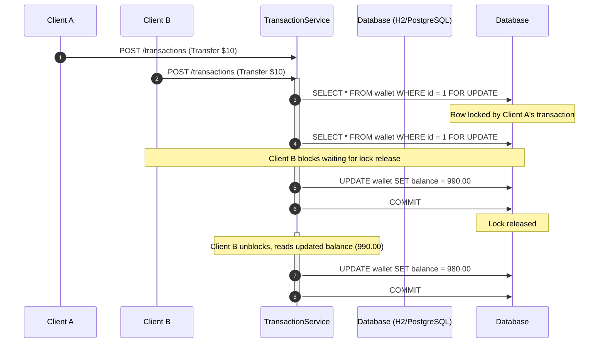
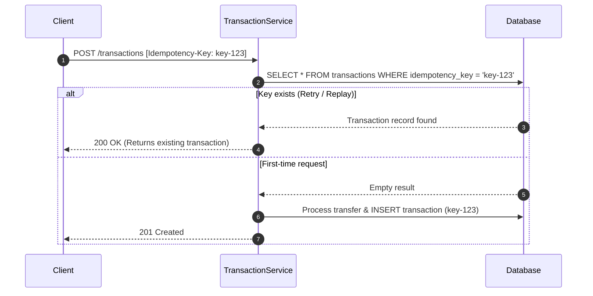

# Financial Transaction API — Concurrency & Idempotency PoC


A production-grade Proof of Concept (PoC) demonstrating database-level **Concurrency Control** (preventing *Lost Updates* and *Race Conditions*) and **Idempotency Handling** (preventing duplicate charges) in a distributed financial transaction system built with **Spring Boot** and **Spring Data JPA**.

---

## 🎯 Problems Solved

### 1. Lost Updates & Race Conditions (Pessimistic Locking)
* **The Challenge:** In high-concurrency environments, multiple threads attempting to debit or transfer funds from the same account simultaneously will read stale balance states, resulting in overwritten balances (*Lost Updates*) or negative balances (*Overdrafts*).
* **The Solution:** Implemented database-level row locks using `@Lock(LockModeType.PESSIMISTIC_WRITE)`. JPA issues a `SELECT ... FOR UPDATE` query, serializing concurrent writes at the database level and queuing rival transactions until the active transaction commits.

### 2. Duplicate Payments (Idempotency Key)
* **The Challenge:** Network dropouts, client-side retries, or accidental double-clicks can cause duplicate payment execution.
* **The Solution:** Utilized an `Idempotency-Key` HTTP header coupled with a `UNIQUE` index in the database. Duplicate requests bearing the same key short-circuit execution and immediately return the original transaction record without altering account balances.

---

## 📐 Sequence Diagrams

### Concurrency Control (Pessimistic Lock)



### Idempotency Flow



---

## 🏗️ Architecture & Package-by-Feature

The application follows a **Package-by-Feature** domain architecture to maximize cohesion, encapsulate domain rules, and enforce bounded contexts:

```text
src/main/java/com/walletapi
├── config/             # Global configurations & exception handling
├── transaction/        # Transaction feature domain
│   ├── Transaction.java
│   ├── TransactionController.java
│   ├── TransactionRepository.java
│   ├── TransactionRequestDTO.java
│   └── TransactionService.java
├── user/               # User account feature domain
│   ├── User.java
│   └── UserRepository.java
└── wallet/             # Wallet feature domain & Pessimistic Locks
    ├── Wallet.java
    └── WalletRepository.java
```

---

## 🧪 Concurrency Test Validation

A multi-threaded integration test (`TransactionServiceConcurrencyTest`) simulates **10 parallel threads** attempting to transfer funds concurrently using Java's `ExecutorService` and `CountDownLatch`.

```bash
mvn test
```

### Sample Output Log:
```text
--- CONCURRENCY TEST RESULT ---
Initial Balance Source: 1000.00 | Initial Balance Destination: 1000.00
Threads Executed: 10 | Amount Per Transfer: 10.00
Final Balance Source: 900.00
Final Balance Destination: 1100.00
[INFO] Tests run: 1, Failures: 0, Errors: 0, Skipped: 0, SUCCESS.
```

---

## ⚡ Design Trade-Offs

| Approach | Advantages | Disadvantages | Selection Criteria |
| :--- | :--- | :--- | :--- |
| **Pessimistic Lock (`FOR UPDATE`)** | Guarantees strict consistency; no retry handling needed on the client. | Higher latency on heavily contested rows. | **Chosen strategy:** Ideal for balance updates and financial transactions. |
| **Optimistic Lock (`@Version`)** | High read throughput; no database row locks held during reads. | Throws exceptions on conflict; requires client-side or application retries. | Better for low-write contention systems. |
| **Atomic SQL Updates** | Extremely fast engine-level execution (`UPDATE w SET balance = balance - X`). | Bypasses JPA entity lifecycle, audit listeners, and in-memory validation rules. | Suitable for simple increment/decrement counters. |

---

## 🚀 Getting Started

### Prerequisites
* **Java:** 17 or higher
* **Maven:** 3.8+

### Build and Run

```bash
# Clone the repository
git clone https://github.com/your-username/wallet-concurrency-poc.git

# Navigate into the project
cd wallet-concurrency-poc

# Run application
mvn spring-boot:run
```

The server starts on `http://localhost:8080`.

### H2 Database Console
* **URL:** `http://localhost:8080/h2-console`
* **JDBC URL:** `jdbc:h2:mem:walletdb`
* **Username:** `sa`
* **Password:** *(leave empty)*

---

## 📮 API Specification

### Execute Transfer
`POST /transactions`

#### Request Headers
```http
Content-Type: application/json
Idempotency-Key: e82b7c12-70b1-4f36-96b2-6cb16905a5a1
```

#### Request Body
```json
{
  "sourceWallet": 1,
  "destinationWallet": 2,
  "amount": 50.00
}
```

#### Response (`201 Created` / `200 OK`)
```json
{
  "id": 1,
  "idempotencyKey": "e82b7c12-70b1-4f36-96b2-6cb16905a5a1",
  "walletSource": { "id": 1, "balance": 950.00 },
  "walletDestination": { "id": 2, "balance": 1050.00 },
  "amount": 50.00,
  "date": "2026-10-20T14:15:00"
}
```

---

## 🔮 Roadmap / Future Enhancements
- [ ] Migrate test suite to **Testcontainers** with real PostgreSQL instances.
- [ ] Implement distributed locking / cache idempotency via **Redis**.
- [ ] Add Prometheus/Micrometer metrics for DB lock wait time observation.